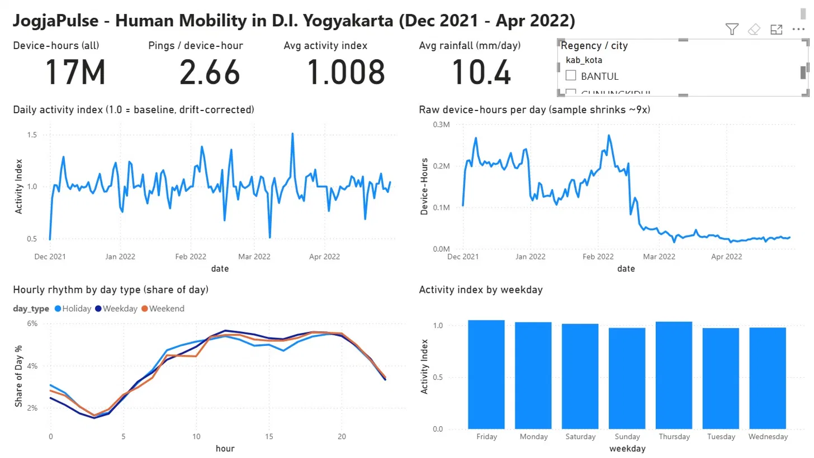
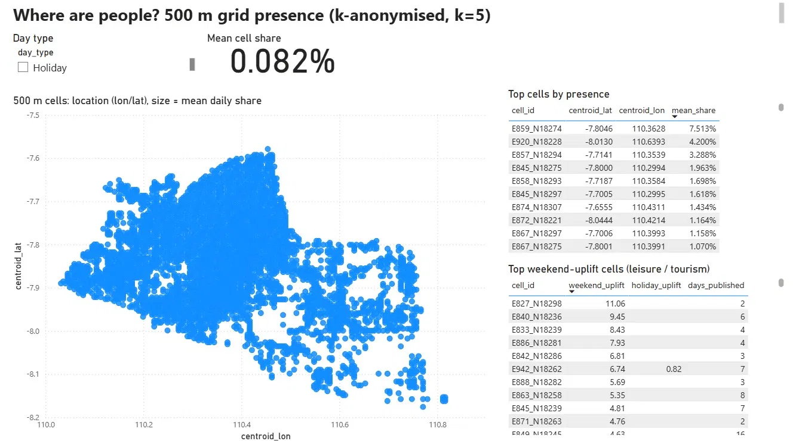
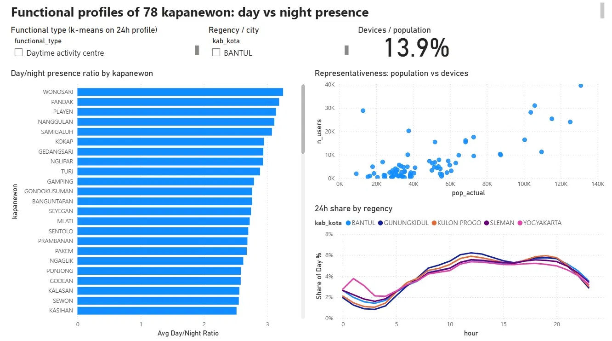
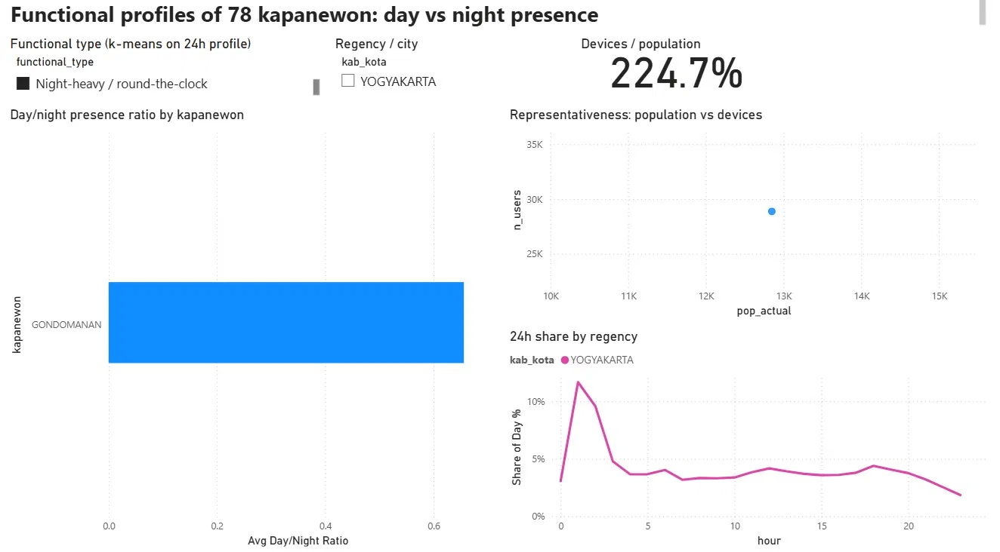
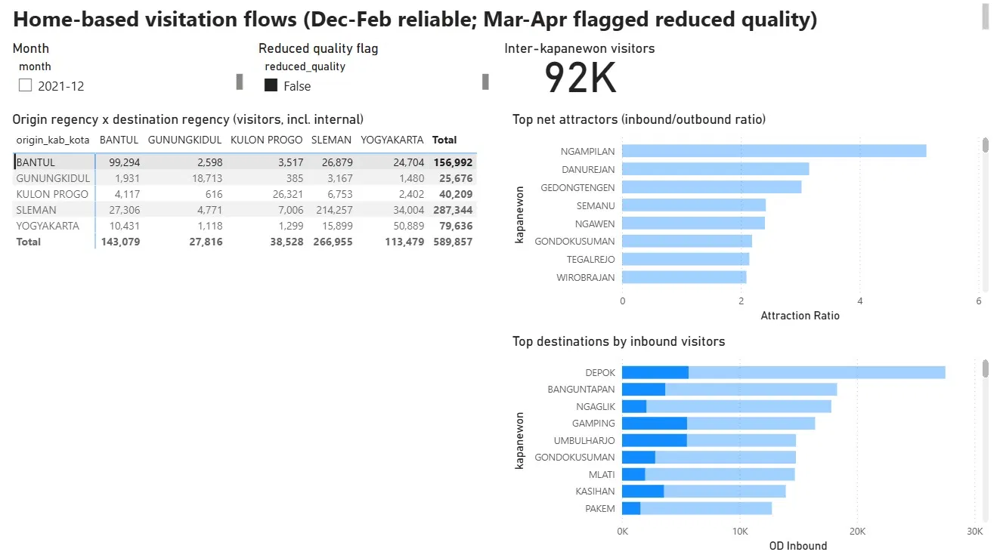
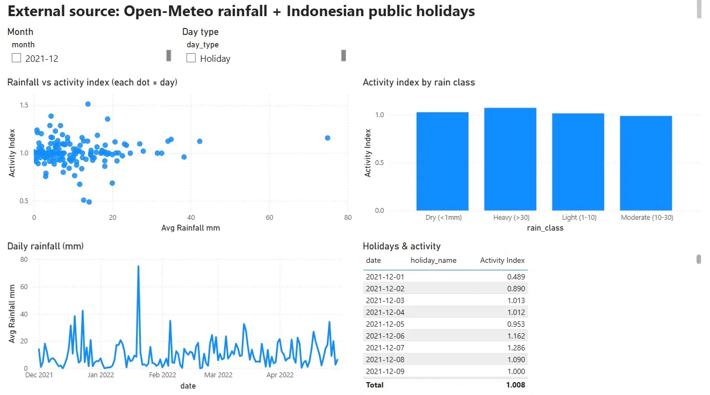
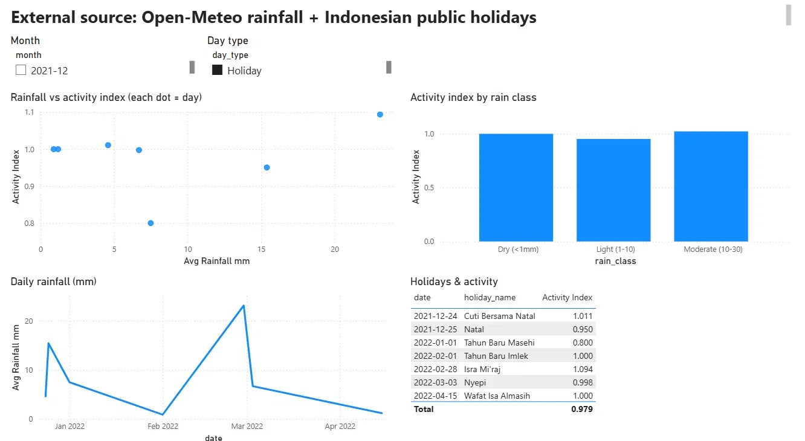
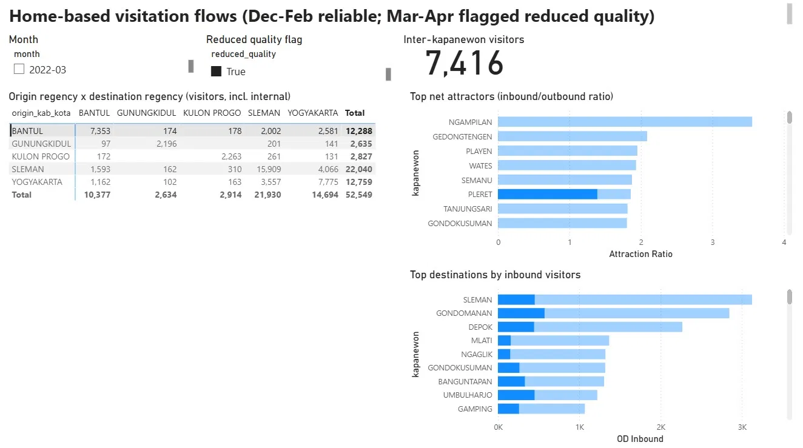

# Dashboard JogjaPulse: Tangkapan Layar dan Insight

Folder ini berisi tangkapan layar dashboard Power BI (`powerbi/JogjaPulse.pbip`) yang dipakai untuk presentasi, beserta penjelasan tiap gambar.

| # | Berkas | Halaman dashboard | Pesan utama |
|---|---|---|---|
| 1 | `01_overview.jpg` | 1. Overview | Sampel menyusut 9×, tetapi ritme aktivitas stabil |
| 2 | `02_hotspots.jpg` | 2. Spatial Hotspots | Kehadiran terpusat di inti kota |
| 3 | `03_profiles.jpg` | 3. Sub-district Profiles | Hampir semua kapanewon ramai siang; data cukup representatif |
| 4 | `04_gondomanan.jpg` | 3. Sub-district Profiles | Gondomanan satu-satunya yang ramai malam |
| 5 | `05_od_dec_feb.jpg` | 4. Origin-Destination | Pusat kota menarik pengunjung 3–5× lebih banyak daripada yang keluar |
| 6 | `06_weather.jpg` | 5. Weather & Holidays | Hujan tidak menurunkan aktivitas |
| 7 | `07_holidays.jpg` | 5. Weather & Holidays | Hanya Tahun Baru yang turun jelas |
| 8 | `08_od_mar_apr.jpg` | 4. Origin-Destination | Alasan data OD Maret–April tidak dipakai |

---

## 1. Overview seluruh DIY

**Insight**
- Jumlah device-hours harian turun sekitar 9× (±208 ribu pada Desember menjadi ±23 ribu pada April), dengan penurunan tajam pada 1 Januari dan 16 Februari 2022.
- Indeks aktivitas tetap di sekitar 1,0 sepanjang periode. Artinya penurunan itu berasal dari komposisi sampel perangkat, bukan dari berkurangnya mobilitas.
- Ritme harian: terendah sekitar pukul 03.00, naik mulai pukul 05.00, dan ramai pada pukul 11.00–20.00 WIB.
- Selisih antara hari kerja dan akhir pekan/libur hanya sekitar 2% dan tidak signifikan (Mann-Whitney p = 0,44).

**Mengapa dipilih:** satu halaman ini memuat konteks data, keterbatasan utamanya, dan cara mengoreksinya (indeks aktivitas).

**Catatan:** indeks aktivitas dihitung untuk seluruh DIY, sehingga tidak berubah ketika slicer kabupaten dipakai. Urutan hari pada grafik batang masih alfabetis.

---

## 2. Hotspot sel 500 m

**Insight**
- Sel-sel aktif menumpuk di inti Kota Yogyakarta dan Sleman bagian selatan, lalu menipis ke arah Gunungkidul dan Kulon Progo.
- Sel teratas (area Malioboro, -7,8046; 110,3628) rata-rata memegang 7,5% kehadiran harian. Sel kedua berada di Gunungkidul (4,2%).
- Rata-rata satu sel hanya memegang 0,082%, sehingga sel teratas sekitar 90× lebih padat daripada rata-rata.

**Mengapa dipilih:** menunjukkan sebaran spasial dalam satu gambar; versi per tipe hari tampak identik sehingga cukup satu.

**Catatan:** tabel "Top weekend-uplift" belum disaring. Sel teratasnya hanya terbit 2–8 hari, jadi angka uplift-nya tidak dapat diandalkan. Hasil yang disaring (minimal 40 hari) ada di `outputs/findings.txt`.

---

## 3. Profil 78 kapanewon

**Insight**
- Hampir semua kapanewon lebih ramai pada siang hari, dengan rasio kehadiran siang/malam antara 2 dan 3.
- Jumlah perangkat mengikuti jumlah penduduk (r log-log = 0,69). Penetrasi agregat 13,9%, dengan median per kapanewon sekitar 9%.
- Satu titik pencilan di kiri atas grafik sebar (banyak perangkat, sedikit penduduk) adalah Gondomanan.

**Mengapa dipilih:** menjawab pertanyaan seberapa representatif data ini, sekaligus mengantar ke temuan Gondomanan.

---

## 4. Gondomanan

**Insight**
- Gondomanan adalah satu-satunya kapanewon dengan tipe "Night-heavy": rasio siang/malam 0,66.
- Jumlah perangkat yang "berumah" di sini mencapai 224,7% dari jumlah penduduk, tanda banyaknya perangkat non-penduduk.
- Profil 24 jam melonjak pada pukul 01.00–02.00, hingga sekitar 12% dari aktivitas sehari.

**Mengapa dipilih:** temuan paling menonjol dan paling menarik untuk didiskusikan.

**Catatan:** 54% device-hours pada pukul 01.00–02.00 berasal dari Maret 2022 saja, sementara aktivitas siangnya pada bulan itu justru turun. Lonjakan ini mungkin artefak data, sehingga tafsir "wisatawan dan hotel" perlu disampaikan sebagai dugaan. Label legenda "YOGYAKARTA" muncul karena garis dikelompokkan per kabupaten/kota; isinya hanya Gondomanan.

---

## 5. Arus asal–tujuan, Desember–Februari

**Insight**
- Sebagian besar kunjungan terjadi di dalam kabupaten sendiri (diagonal matriks). Arus lintas terbesar adalah Sleman ke Kota Yogyakarta (34.004), Sleman–Bantul (±27 ribu per arah), dan Bantul ke Kota Yogyakarta (24.704).
- Total pengunjung lintas kapanewon sekitar 355 ribu. Kartu "92K" pada gambar hanya menghitung asal Bantul, karena baris Bantul sedang dipilih.
- Penarik pengunjung terkuat: Ngampilan (rasio masuk/keluar 5,1), Danurejan (3,2), dan Gedongtengen (3,0). Tujuan dengan pengunjung terbanyak adalah Depok.
- Bagian biru tua pada grafik tujuan adalah porsi dari Bantul: warga Bantul banyak menuju Depok, Gamping, dan Umbulharjo.

**Mengapa dipilih:** satu-satunya tampilan OD dengan data yang andal (flag `reduced_quality = False`).

**Catatan:** angka adalah jumlah perangkat unik per bulan yang dijumlahkan lintas tiga bulan, jadi bukan jumlah orang unik dan bukan jumlah perjalanan.

---

## 6. Hujan dan aktivitas

**Insight**
- Titik-titik pada grafik sebar membentuk pola datar: tidak ada hubungan berarti antara curah hujan dan indeks aktivitas (Spearman rho = 0,04; p = 0,65).
- Indeks per kelas hujan hampir sama. Hari hujan lebat (> 30 mm) justru sekitar 1,08, tetapi hanya ada 5 hari.
- Rata-rata curah hujan 10,4 mm/hari, dengan puncak sekitar 75 mm pada Januari.

**Mengapa dipilih:** menunjukkan pemakaian sumber data kedua (Open-Meteo); hasil "tidak ada pengaruh" tetap merupakan temuan.

**Catatan:** curah hujan memakai satu titik cuaca untuk seluruh DIY.

---

## 7. Hari libur

**Insight**
- Dari 7 hari libur dalam periode data, rata-rata indeks aktivitas 0,979, nyaris sama dengan hari biasa.
- Hanya Tahun Baru Masehi yang turun jelas (0,80). Natal 0,95; hari libur lainnya sekitar 1,0; Isra Mi'raj sedikit di atas (1,09).

**Mengapa dipilih:** tabelnya pendek, bernama, dan mudah dibaca penonton.

**Catatan:** tujuh titik terlalu sedikit untuk kesimpulan statistik; ini gambaran deskriptif.

---

## 8. Arus asal–tujuan, Maret–April (pendukung)

**Insight**
- Total pengunjung pada matriks hanya 52.549, dibanding 589.857 pada Desember–Februari.
- Beberapa pasangan kabupaten kosong karena di bawah ambang k = 5, dan peringkat tujuan berubah (Sleman dan Gondomanan naik ke atas; Playen dan Wates muncul sebagai penarik).

**Mengapa dipilih:** bukti visual mengapa data OD Maret–April ditandai berkualitas rendah dan tidak dipakai dalam analisis.